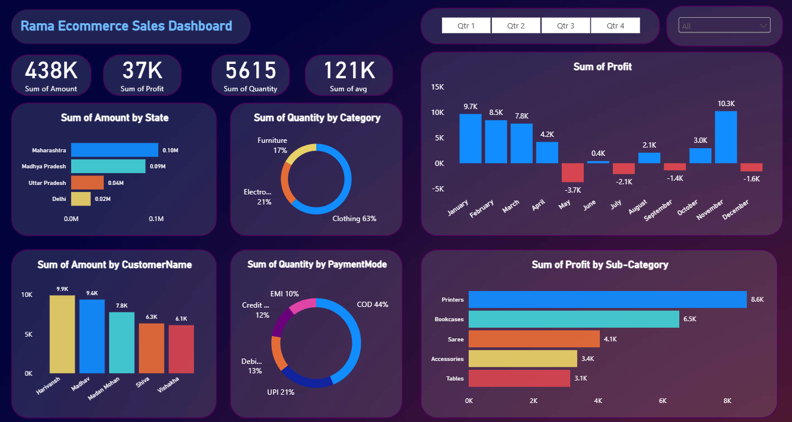

# Rama Ecommerce Sales Dashboard

An end-to-end Power BI project that analyses the sales performance of an ecommerce business: sales and profit, customer behaviour, payment modes and performance by state and product.

> Built as a learning project by following a Rishabh Mishra Power BI tutorial on YouTube.

---

## Dashboard preview

---

## Key insights

| Area | Finding |
| :--- | :--- |
| **Overview** | Total sales of **438K** and profit of **37K** from **5,615 units** sold (profit margin of about 8.4%). |
| **Category** | **Clothing makes up 63%** of units sold, followed by Electronics (21%) and Furniture (17%). |
| **Payment mode** | **Cash on delivery is the most used (44%)**, followed by UPI (21%), Debit card (13%), Credit card (12%) and EMI (10%). |
| **States** | **Maharashtra (0.10M)** and **Madhya Pradesh (0.09M)** lead sales, followed by Uttar Pradesh (0.04M) and Delhi (0.02M). |
| **Profit trend** | **November had the highest profit (10.3K)**, followed by January (9.7K) and February (8.5K). May, July, September and December ended in a loss. |
| **Sub-category** | **Printers are the most profitable (8.6K)**, then Bookcases (6.5K), Saree (4.1K), Accessories (3.4K) and Tables (3.1K). |
| **Customers** | Top customers by amount are Harivansh (9.9K), Madhav (9.4K) and Madan Mohan (7.8K). |

---

## Recommendations

These suggestions are based on the findings above.

- **Promote high-profit products:** Push sub-categories like Printers and Bookcases.
- **Look into loss-making months:** Check discounts and costs in May, July, September and December.
- **Reduce COD:** Encourage UPI and prepaid payments, since COD is the largest share at 44%.
- **Grow beyond the top states:** Maharashtra and Madhya Pradesh lead, so campaigns in other states can add sales.

---

## What the dashboard includes

- KPI cards for total amount, profit, quantity and average
- Sales amount by state
- Quantity by category and by payment mode
- Monthly profit with profit and loss shown in different colours
- Profit by sub-category
- Top customers by amount
- Quarter slicer (Qtr 1 to Qtr 4) to filter the view

---

## Files in this repository

| File | Description |
| :--- | :--- |
| `Rama Ecommerce Sales Dashboard.pbix` | Power BI report file |
| `dashboard.png` | Preview image of the dashboard |
| `README.md` | Project documentation |

---

## About me

**Satyam Mishra**, B.Tech CSE (AI) student and aspiring Data Analyst.

- LinkedIn: [satyammishraaa](https://www.linkedin.com/in/satyammishraaa/)
- GitHub: [satyammishra19](https://github.com/satyammishra19)
- Email: mishrasatyam1912@gmail.com
